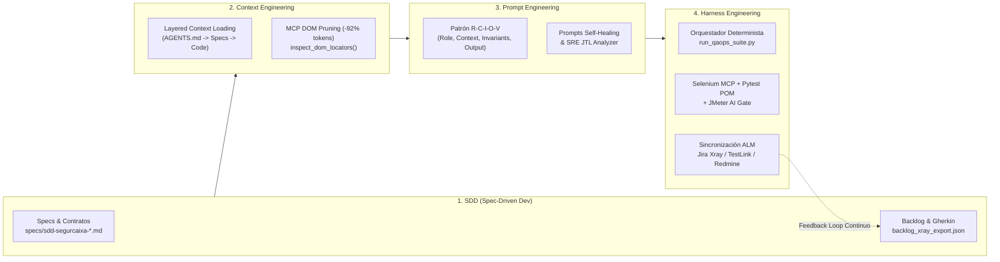

# SegurCaixa Adeslas (`/servicios-para-clientes`) — Stack QAOps de Ayesa Digital

Simulación integral del portal **[Servicios para Clientes de SegurCaixa Adeslas](https://www.segurcaixaadeslas.es/servicios-para-clientes)** junto con el ecosistema de ingeniería de calidad continua (**QAOps**) e **Ingeniería Agéntica (SDD, Prompt, Context & Harness Engineering)** de **Ayesa Digital**:

1. **Portal Web + API REST Simulada (`portal-adeslas/`)**:
   - Flujos reales de **Cuadro Médico y Urgencias 24h**, **Autorizaciones Médicas Online**, **Reembolso de Facturas (80%/90%)**, **Área Cliente + Tarjeta Digital** y **Videoconsulta Médica 24h**.
2. **Hub ALM Unificado (`alm-backlog/` y `/alm-dashboard`)**:
   - Simulación interactiva con vistas conmutables para **Jira + Xray**, **TestLink / TestPlan** y **Redmine**, además de exportaciones oficiales listas para importar (`JSON`, `XML`, `CSV`) y el **Master Test Plan (`TEST_PLAN_MASTER.md`)**.
3. **Automatización E2E Selenium + Self-Healing POM (`selenium-qaops/`)**:
   - Suite **Pytest + Selenium WebDriver** (`SCA-TC-001` a `SCA-TC-010`) con localizadores auto-reparables y reporte automático en vivo al Hub ALM.
4. **Servidor MCP de Selenium para Agentes IA (`mcp-selenium-server/`)**:
   - Servidor **Model Context Protocol (JSON-RPC 2.0 stdio)** que expone herramientas para abrir sesión, navegar, inspeccionar selectores resilientes del DOM, ejecutar flujos de SegurCaixa Adeslas y sincronizar ejecuciones con Jira/TestLink/Redmine.
5. **JMeter Asistido por IA (`jmeter-ai/`)**:
   - Plan nativo Apache JMeter 5.6 (`segurcaixa_servicios_clientes.jmx`), datasets CSV y motor cognitivo `ai_jmeter_assistant.py` que ejecuta pruebas de carga concurrentes, genera ficheros `.jtl`, calcula `P50/P90/P95/P99` + `Apdex` y detecta cuellos de botella automáticamente.

---

## 🧠 Ingeniería Agéntica: SDD, Prompt, Context & Harness Engineering

La arquitectura del proyecto está diseñada siguiendo los cuatro pilares de **Ingeniería Agéntica de Software y QAOps** (documentados en detalle en [`AGENTS.md`](./AGENTS.md), [`AGENT.md`](./AGENT.md) y [`specs/sdd-segurcaixa-servicios-clientes.md`](./specs/sdd-segurcaixa-servicios-clientes.md)):



### 1. SDD — Specification-Driven Development
- **La especificación es la fuente única de verdad**: Ningún endpoint ni caso de prueba se modifica sin actualizar o verificar primero el contrato formal en [`specs/sdd-segurcaixa-servicios-clientes.md`](./specs/sdd-segurcaixa-servicios-clientes.md) y el backlog ejecutable en [`alm-backlog/jira-xray/backlog_xray_export.json`](./alm-backlog/jira-xray/backlog_xray_export.json).
- **Trazabilidad 1:1 Determinista**:
  - **Épica (`SCA-EP-XX`)** → **Historia (`SCA-US-XXX`)** → **Especificación Gherkin (`SCA-TC-XXX` / `TL-SCA-XXX` / `#40XX`)** → **Test Automatizado (`@pytest.mark.xray("SCA-TC-XXX")`)** → **Quality Gate CI/CD**.
- **Invariantes de Dominio Verificados**:
  - `RN-AUT-01..03`: Validación de tarjeta Adeslas (`12-16` dígitos), autorización inmediata (`AUT-2026-XXXXX`) vs. derivación facultativa en estudios genéticos (`PENDIENTE_REVISION_MEDICA`).
  - `RN-RMB-01..02`: Cálculo matemático de reembolso (**90%** Adeslas Premier, **80%** Adeslas Extra) y validación estricta de formato IBAN (`^ES\d{22}$`).
  - `SLA-PERF-01`: Percentil 95 (`P95`) `< 450 ms`, tasa de error `<= 1.0%` y `Apdex >= 0.90`.

### 2. Prompt Engineering (Patrón `R-C-I-O-V`)
En [`AGENTS.md`](./AGENTS.md) se incluyen los **Prompts Maestros** estandarizados bajo la estructura **Role · Context · Invariants · Output Contract · Verification**:
- **Prompt de Generación E2E Selenium POM**: Obliga al agente a usar localizadores resilientes (`find_healed`), prohibiendo esperas fijas (`time.sleep`) o selectores acoplados a estilos visuales.
- **Prompt de Auto-Curación (Self-Healing via MCP)**: Guía al agente para invocar `selenium_inspect_dom_locators`, emparejar semánticamente un selector roto y reparar el Page Object automáticamente.
- **Prompt de Diagnóstico SRE JMeter IA**: Analiza distribuciones `P50/P90/P95/P99` sobre el fichero `.jtl`, detecta anomalías de latencia (como la validación síncrona de baremos en `Estudio Genético Oncológico`) y las vincula con defectos del Backlog (`SCA-BUG-201`).

### 3. Context Engineering (Optimización de Ventana de Contexto)
- **DOM Pruning en el Servidor MCP (-92% de tokens)**: La herramienta `selenium_inspect_dom_locators` en [`mcp-selenium-server/server.py`](./mcp-selenium-server/server.py) poda el árbol HTML completo y entrega al agente únicamente un catálogo JSON compacto de elementos interactivos (`id`, `data-testid`, `recommendedCss`, `selfHealingFallbackCss`).
- **Carga de Contexto por Capas (Layered Context)**:
  1. **Capa 0**: [`AGENTS.md`](./AGENTS.md) + [`specs/sdd-segurcaixa-servicios-clientes.md`](./specs/sdd-segurcaixa-servicios-clientes.md).
  2. **Capa 1**: Contratos y estado en [`alm-backlog/jira-xray/backlog_xray_export.json`](./alm-backlog/jira-xray/backlog_xray_export.json).
  3. **Capa 2**: Código fuente específico bajo modificación.
  4. **Capa 3**: Resumen ejecutivo [`jmeter-ai/results/AI_PERFORMANCE_REPORT.md`](./jmeter-ai/results/AI_PERFORMANCE_REPORT.md) en lugar de volcar trazas crudas `.jtl`.

### 4. Harness Engineering (Arnés de Ejecución y Verificación Cerrada)
El proyecto proporciona un **arnés de verificación multicapa** que permite a cualquier agente o pipeline CI/CD validar su trabajo en menos de 10 segundos sin intervención humana:
- **Orquestador Maestro (`run_qaops_suite.py`)**: Detecta o levanta el servidor en el puerto `8080`, ejecuta secuencialmente las 4 puertas de calidad y garantiza el cierre limpio (`try/finally`).
- **Arnés MCP (`mcp-selenium-server/server.py --selftest`)**: Valida la comunicación con el navegador Headless, la extracción de 40 selectores del DOM, la ejecución de flujos de negocio y la captura de evidencias PNG.
- **Arnés Funcional Self-Healing (`selenium-qaops/conftest.py`)**: Conmuta automáticamente entre Chrome Headless y Edge Headless y publica los tiempos y estados de cada test en `/api/v1/qaops/test-runs`.
- **Arnés de Carga Dual (`jmeter-ai/ai_jmeter_assistant.py`)**: Soporta tanto el binario nativo de Apache JMeter 5.6 como su motor concurrente integrado generador de `.jtl`, publicando métricas en `/api/v1/qaops/jmeter-report`.

---

## 📂 Estructura del Proyecto

```text
├── AGENTS.md                                   # Blueprint de SDD, Prompt, Context & Harness Engineering
├── AGENT.md                                    # Guía rápida para agentes IA y subagentes QAOps
├── specs/
│   └── sdd-segurcaixa-servicios-clientes.md    # Especificación SDD formal y contratos verificables
├── portal-adeslas/
│   ├── app.py                                  # Servidor Flask (Portal + API REST + Hub ALM)
│   └── templates/
│       ├── servicios_clientes.html             # Simulación UI /servicios-para-clientes
│       └── alm_dashboard.html                  # Dashboard interactivo Jira Xray / TestLink / Redmine / JMeter IA
├── alm-backlog/
│   ├── TEST_PLAN_MASTER.md                     # Plan de Pruebas Maestro ISO 29119 / ISTQB
│   ├── jira-xray/backlog_xray_export.json      # Épicas, Historias, Test Plan, Casos Xray (Gherkin) y Defectos
│   ├── testlink/segurcaixa_testplan_testlink.xml # Exportación jerárquica XML oficial para TestLink
│   └── redmine/redmine_issues_backlog.csv      # Backlog e Issues QA en formato CSV de Redmine
├── selenium-qaops/
│   ├── conftest.py                             # Fixtures WebDriver Headless + Hook de sincronización ALM
│   ├── pages/servicios_clientes_page.py        # Page Object Model con Self-Healing Locators
│   └── tests/test_servicios_clientes_e2e.py    # 10 Tests automatizados (SCA-TC-001 a SCA-TC-010)
├── mcp-selenium-server/
│   ├── server.py                               # Servidor MCP de Selenium (stdio + modo --selftest)
│   └── mcp_config.json                         # Configuración MCP para Antigravity / Claude / Cursor
├── jmeter-ai/
│   ├── ai_jmeter_assistant.py                  # Ejecutor concurrente JTL + Analizador IA de rendimiento
│   ├── plans/segurcaixa_servicios_clientes.jmx # Plan Apache JMeter 5.6 (3 Thread Groups)
│   ├── data/busquedas_cuadro_medico.csv        # Dataset parametrizado JMeter
│   └── results/                                # Ficheros .jtl e Informe IA en Markdown
├── ci-cd/
│   └── Jenkinsfile                             # Pipeline declarativo CI/CD QAOps
├── .github/workflows/ayesa-qaops-pipeline.yml  # Workflow GitHub Actions QAOps
└── run_qaops_suite.py                          # Arnés Orquestador E2E de toda la suite QAOps
```

---

## 🚀 Ejecución Rápida

### 1. Ejecutar el Arnés Completo de Certificación QAOps en un solo comando
```powershell
python run_qaops_suite.py
```

### 2. Levantar el Portal SegurCaixa Adeslas y el Hub ALM para exploración interactiva
```powershell
python portal-adeslas/app.py
```
- **Portal Servicios para Clientes**: `http://127.0.0.1:8080/servicios-para-clientes`
- **Hub ALM (Jira Xray / TestLink / Redmine / JMeter IA)**: `http://127.0.0.1:8080/alm-dashboard`
